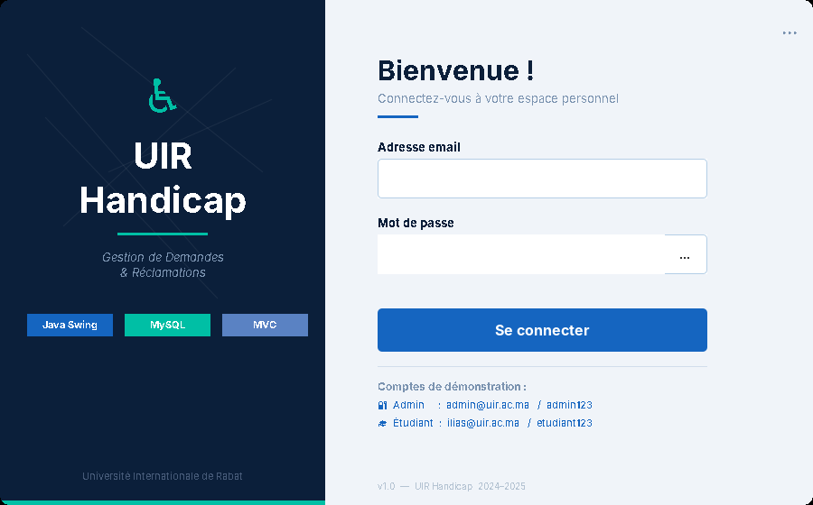
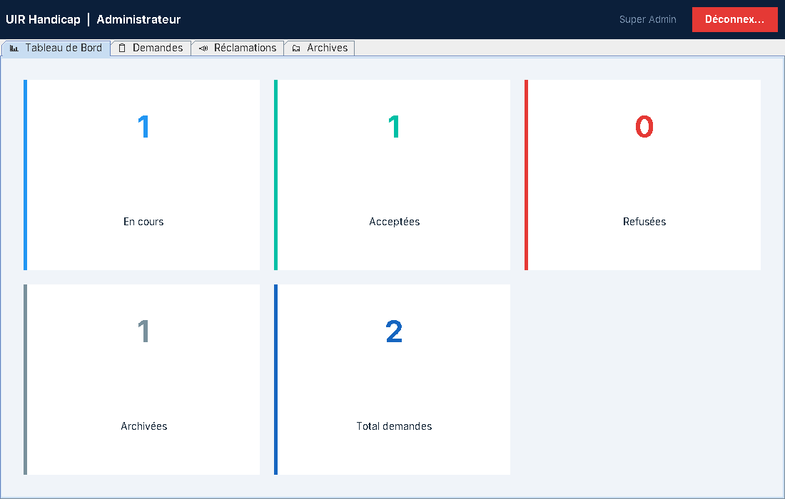
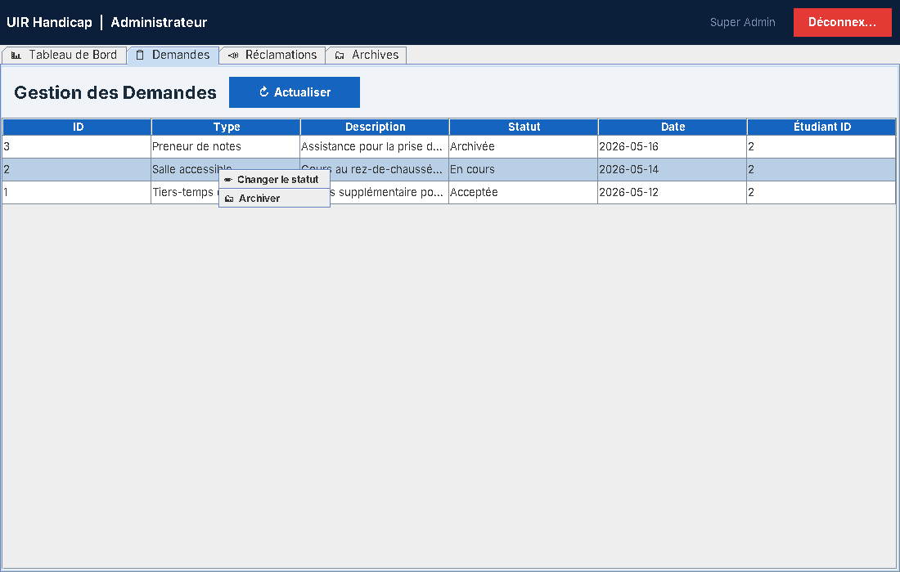
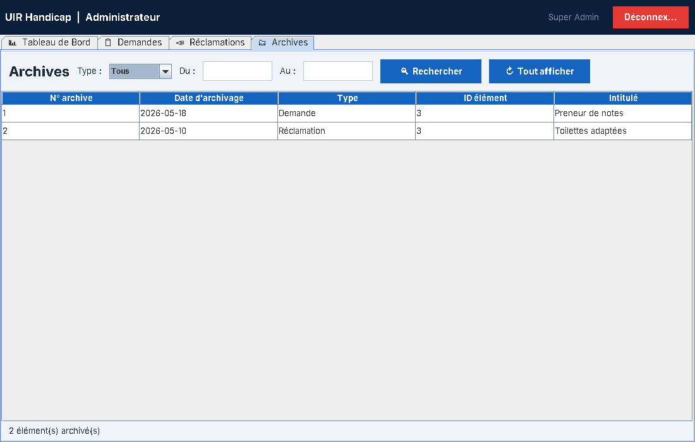
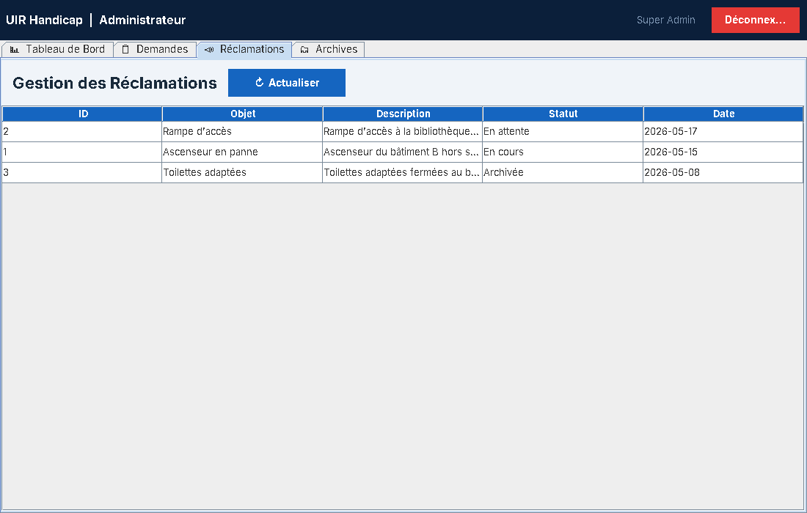
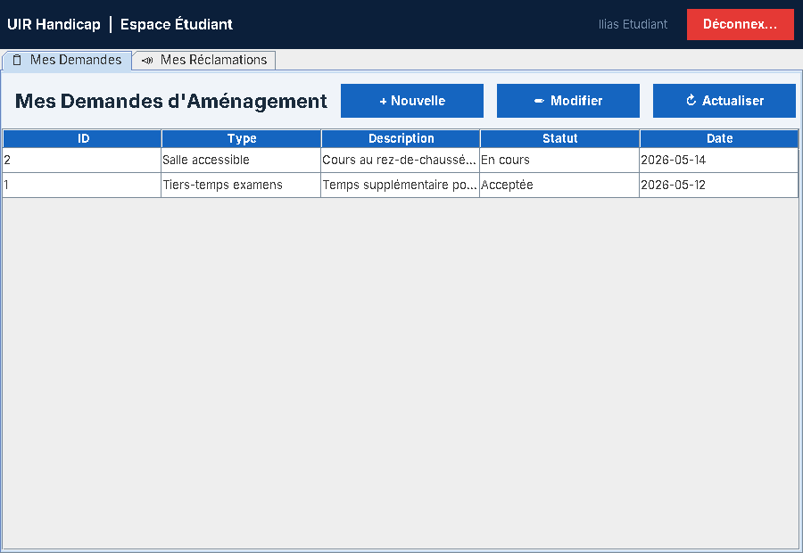
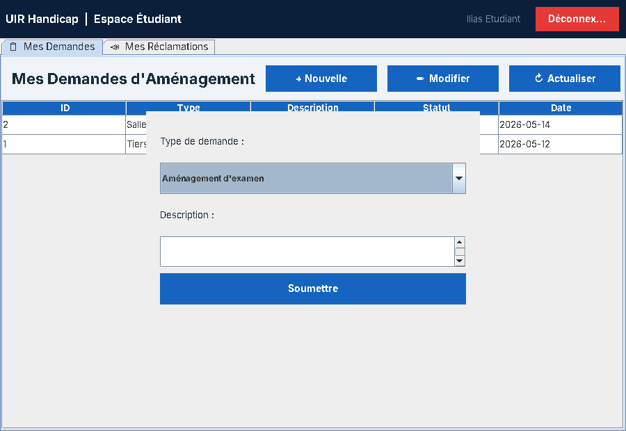
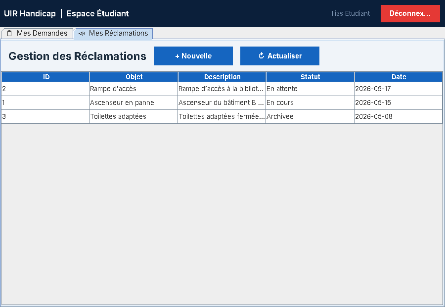

# UIR Handicap — Accommodation Requests & Complaints (Java Swing + MySQL)

Desktop application for the disability support office of the Université Internationale de Rabat: students with disabilities submit **accommodation requests** (extra exam time, accessible rooms, note-taking help…) and **complaints** (broken lift, blocked ramp…); administrators review them, change their status, archive them and keep a full history of every action.

Built with Java Swing following an **MVC + DAO** architecture — May 2026.



## Features

| Role | What they can do |
|---|---|
| **Student** | Create and edit accommodation requests, file complaints, follow the status of each one |
| **Admin** | Dashboard with counters, review every request and complaint, change status (right-click), archive, search the archives |

- **Request statuses:** En cours → Acceptée / Refusée → Archivée
- **Complaint statuses:** En attente → En cours → Résolue → Archivée
- **Action history:** every creation, edit, status change and archiving is recorded with its author and date (`historique_action` table)
- **Archives:** soft delete (nothing is lost) + multi-criteria search by type and date range
- **Transactions:** each status change and its history entry are saved together (commit / rollback)

| Admin dashboard | Request management (right-click menu) |
|---|---|
|  |  |

| Archives search | Complaints (admin) |
|---|---|
|  |  |

| Student — my requests | Student — new request | Student — my complaints |
|---|---|---|
|  |  |  |

## Security

- Passwords hashed with **SHA-256 + random 16-byte salt** (`controller/PasswordUtil.java`, format `salt$hash`)
- All SQL queries use **prepared statements**
- Role-based windows: admins and students get different interfaces after login (`controller/Session.java`)

## Architecture

```
src/
├── Main.java                 Entry point (opens the login window)
├── model/                    Utilisateur, Administrateur, PersonneHandicapee, Demande, Reclamation, Archive, HistoriqueAction
├── dao/                      DBConnection + one DAO per table (JDBC, transactions)
├── controller/               Session, PasswordUtil, UIFactory (shared UI styles)
└── view/                     LoginFrame, MainFrame (admin), HandicapeeMainFrame (student),
                              DemandesPanel, ReclamationsPanel, ArchivesPanel
uir_handicap.sql              Database schema + demo accounts
```

## Run it

1. **Database:** import `uir_handicap.sql` in MySQL 8 or MariaDB (MySQL Workbench, phpMyAdmin or `mysql -u root -p < uir_handicap.sql`)
2. **Driver:** download `mysql-connector-j-9.7.0.jar` into `libs/` (see `libs/README.md`)
3. **Credentials:** if your MySQL `root` has a password, set it in `src/dao/DBConnection.java`
4. **Launch:**
   - **IntelliJ IDEA:** open the folder, then run `src/Main.java`
   - **Windows, no IDE:** double-click `lancer.bat` (compiles and starts the app)

Demo accounts (also shown on the login screen — click one to fill the form):

| Role | Email | Password |
|---|---|---|
| Admin | `admin@uir.ac.ma` | `admin123` |
| Student | `ilias@uir.ac.ma` | `etudiant123` |

## Tech stack

Java 8+ · Swing · MySQL / MariaDB · JDBC · MVC + DAO

## Author

**Riyad Nouar**
